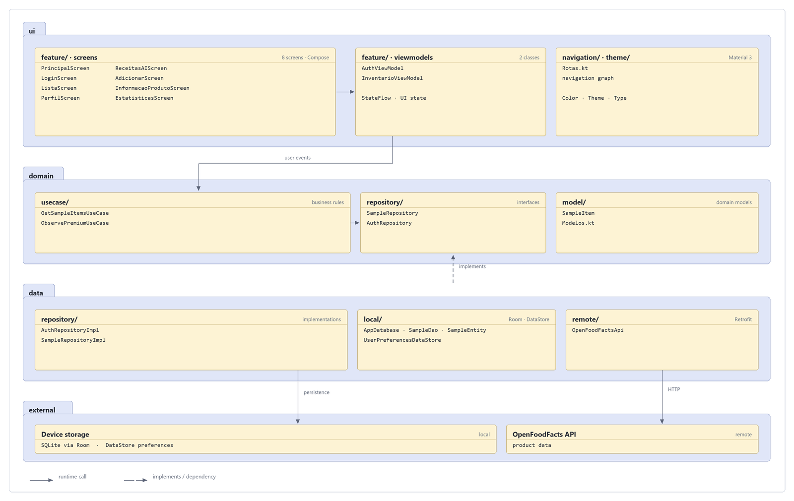

 # ZeroWaste App


Smart pantry management assistant developed as the final project for the Mobile Application Development course at **ISEL**.

Designed to help individuals save money and reduce food waste through intuitive inventory tracking, proactive insights and gamified features.


## Overview


Managing food expiration dates and planning meals efficiently can be challenging. ZeroWaste is an Android application that combines a clean mobile interface with intelligent features to keep track of pantry inventory, suggest recipes based on available ingredients and encourage sustainable consumption habits.

The application benefits from modern Android architecture standards, offline capabilities and simulated freemium mechanics to provide a complete mobile experience.


## Features


- User authentication and account registration
- Intuitive main dashboard for quick feature access
- Product creation and pantry inventory management
- AI-powered recipe generation based on available ingredients
- AI-generated daily tips and insights to encourage waste reduction
- Statistics and visual insights into pantry usage and household impact
- User profile and account management
- Shared application state between users
- Multimedia support
- Offline mode
- Freemium model with free usage and simulated paid subscription


## Architecture



The application follows the MVVM architectural pattern combined with the Repository pattern. It uses Jetpack Compose for the UI, Room for local database management, DataStore for user preferences and Retrofit for network requests. **`ui/`**, one package per feature, which are `auth`, `inventory`, `ai_agent`, `statistics`, `profile`, each with its Compose screens and a `ViewModel` exposing `StateFlow`. Navigation is centralised in `ui/navigation/Rotas.kt`, and the Material 3 theme lives in `ui/theme` **`domain/`**, use cases, repository contracts and the domain model. `SampleRepository` exposes only two operations, `observeItems(): Flow<List<SampleItem>>` and `refresh(): Result<Unit>` and knows nothing about Android. **`data/`**, the other side of those contracts: `AuthRepository`, Firebase Auth for sessions, Firestore for profiles and family sharing, the Room database behind the pantry inventory, DataStore for preferences and a Retrofit client for OpenFoodFacts. **`core/`**,  `ConnectivityObserver`, which the ViewModels use to fall back to offline mode.

The UI observes a `Flow` from the database and `refresh()` writes network results back into it, so a failed request never wipes what is already on screen.


## Tech stack


Kotlin, Jetpack Compose, Material 3, Navigation Compose, ViewModel, StateFlow, Room, DataStore, Retrofit.


## Getting started


**Prerequisite:** [Android Studio](https://developer.android.com/studio) and an Android device or emulator.


```bash
git clone https://github.com/Gon1507/final-project-Gon1507.git
cd final-project-Gon1507
cp local.properties.example local.properties
```
Open the project folder in Android Studio, sync the Gradle files, and run the application on your device.


## Usage Steps


1. Log in or create a new user account.
2. Add pantry products and track expiration dates via the inventory dashboard.
3. Explore AI-generated recipes using the ingredients currently left in your pantry.
4. Check daily tips and monitor your personal consumption statistics and impact.
5. Manage account settings, offline modes and simulated subscription tiers.


## Repository structure


```
app/
├── build.gradle.kts          Compose, Room, Retrofit, DataStore
└── src/main/
    ├── AndroidManifest.xml   Permissions and activity declaration
    ├── java/com/example/zerowaste/
    │   ├── DamApp.kt         Application class, manual dependency injection
    │   ├── MainActivity.kt   Single activity that hosts the Compose navigation
    │   ├── core/             Network state for offline mode
    │   ├── data/
    │   │   ├── local/        Room database, DAO, entity and DataStore preferences
    │   │   ├── remote/       OpenFoodFactsApi, Retrofit client
    │   │   └── repository/   AuthRepository
    │   ├── domain/
    │   │   ├── model/        SampleItem
    │   │   ├── repository/   SampleRepository interface
    │   │   └── usecase/      GetSampleItemsUseCase, ObservePremiumUseCase
    │   ├── model/            Modelos.kt, shared data models
    │   └── ui/
    │       ├── feature/      ai_agent · auth · inventory · profile · statistics
    │       ├── navigation/   Rotas.kt, navigation graph and routes
    │       └── theme/        Color, Theme, Type, Material 3
    └── res/                  Launcher icons, drawables and string/theme values
docs/
├── arquitetura.png           Design, class diagram
build.gradle.kts              Root build, plugins and versions
settings.gradle.kts           Module registration and repositories
gradle.properties             Build flags
gradlew / gradlew.bat         Gradle wrapper
local.properties.example      Template for SDK path and API keys
```


## Notes


- Configuration secrets and local properties must be defined locally using local.properties.
- All sample screens and data are designed for academic and portfolio demonstration purposes.
